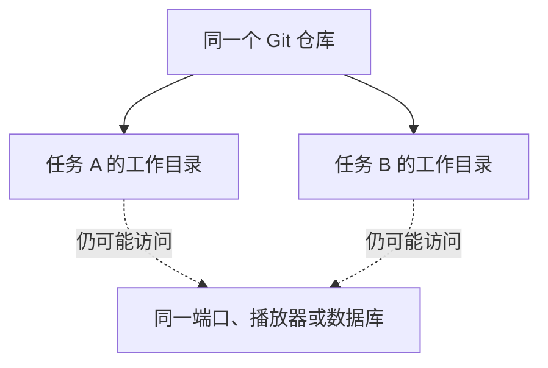

# Git worktree 如何支持多个聊天协作

核对日期：2026-11-05  
分类：计算机与工具 → Git

**worktree 为同一个 Git 仓库提供多个工作目录，适合隔离独立任务的文件修改；它不会自动同步聊天，也不会隔离所有运行资源。**

## 本篇学习重点

- **建议掌握**：隔离工作目录不等于隔离端口、播放器和数据库；按任务划分更合适。
- **用时查阅**：Git 命令、分支名和工作目录路径。
- **可以要求 Codex**：请给独立修改任务分配工作目录，并检查服务和数据是否仍共享。

## 我的问题

多个 Codex 聊天同时修改一个项目，是否每个聊天都应该有一个“git tree”？这里更准确的名称是 Git worktree。

Git worktree 是 Git 的能力。各工作目录拥有各自的检出文件、索引和 HEAD，同时共享仓库的部分数据。它可以使用独立分支，也可以使用 detached HEAD，即 HEAD 直接指向一个提交。[Git 官方说明](https://git-scm.com/docs/git-worktree)

Codex 将 worktree 创建和管理集成到应用中，官方说明其管理的 worktree 默认可以在 detached HEAD 状态工作。因此“每个 worktree 必须立即建立独立分支”并不成立。[Codex 官方说明](https://learn.chatgpt.com/docs/environments/git-worktrees)

## 如何分工比较合适

按独立修改任务分配工作目录，而不是机械地为每个聊天创建一个。只读审查和讨论可以共用目录。

例如游戏项目可以分为“技巧学习”和“游戏运行”两个任务；各自验证修改，再由一个负责人集成。worktree 降低直接互相覆盖工作文件的风险，但合并时仍可能发生冲突。

## 它没有解决什么

实线表示工作目录关系；虚线提醒外部资源仍需协调。

- 不会自动让不同聊天知道彼此的讨论和意图，仍需交接记录。
- 不会阻止两个进程操作同一个游戏、占用同一端口或访问同一个外部数据库。
- 运行数据、密钥、依赖和共享状态仍需明确如何管理。

## 多个聊天已经混改时

先暂停对共享文件的并行写入，汇总修改和验证结果；检查忽略规则，保存可回退的 Git 基线，再按任务拆分工作目录。

引用聊天当时报告游戏项目尚未初始化 Git。这是当时的检查结果，不代表现在仍然如此；本学习笔记没有重新检查或修改游戏项目。

## 回顾问题

- worktree 与分支分别代表什么？
- 为什么不同 worktree 的程序仍可能争用同一个端口？

## 来源

- 原始讨论：学习消除技巧（私人资料，未公开）
