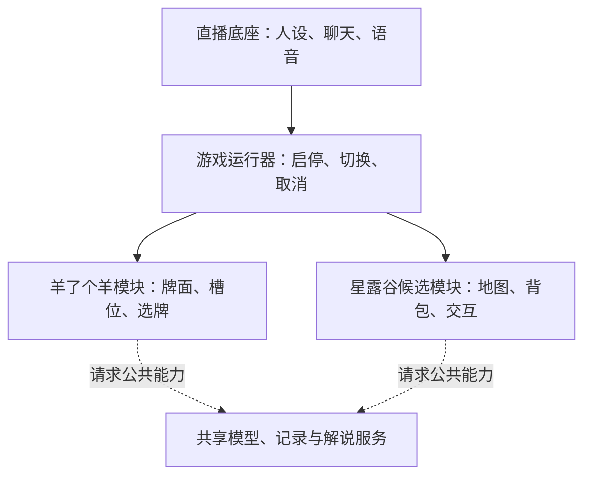

# 多游戏模块如何做到解耦与复用

整理日期：2026-11-05  
分类：软件工程 → 模块设计

**统一共同流程，让差异留在模块内部；判断解耦要看依赖与行为，不只看文件夹是否分开。**

## 本篇学习重点

- **建议掌握**：统一公共流程和服务，保留游戏专属规则；同进程模块不是故障沙箱。
- **用时查阅**：游戏适配接口、桥接实现和注册代码。
- **可以要求 Codex**：请说明共享哪些服务、隔离哪些状态，并验证旧游戏不受预期场景影响。

## 大肥羊的三层边界

图中星露谷是设计示例，不表示已经接入。边界表示职责分离，不表示已实现进程级故障隔离。

| 部分 | 共享什么 | 不应知道什么 |
|---|---|---|
| 角色与直播底座 | 人设、聊天、观众记忆、语音 | 选牌或浇水的具体规则 |
| 游戏运行器 | 启停、切换、超时、记录 | 槽位容量、农田和背包格式 |
| 游戏模块 | 本游戏的观察、规则、动作和验证 | 其他游戏的内部状态 |

一个游戏通过明确的服务接口请求模型、保存记录或提交解说事件，而不是读取主服务的一堆全局变量。这种把依赖从外部传入的做法称为依赖注入；测试时也可以提供替代服务。

共同流程可以是“观察 → 决策 → 校验 → 执行 → 确认”。接口名称相同，不代表所有游戏必须返回同一种状态：羊了个羊关心牌面，星露谷关心地图、体力和背包。

## 快慢不同的动作如何配合

星露谷方案中，模型决定“先浇水再买种子”，本地执行器处理移动、工具使用和等待动画。耗时较长的模型规划不必承担每次按键的实时控制。

技能要能报告部分完成、失败原因和实际结果。例如“浇水 8 块，剩 3 块，水壶没水”，比“已按浇水键”更适合下一步决策。

## 复用也要保留隔离

人格可共享，游戏规则和策略按游戏区分，钱、任务和人物关系等状态还要按存档隔离。换游戏时应使旧计划失效，并释放持续按键等输入。

原聊天的做法是先用具体游戏验证公共流程，真实出现重复需求后再提取组件。地图寻路不应为了“通用”提前塞进所有游戏的必备接口。

## 怎样验收

检查新游戏关闭时旧游戏是否正常、切换后有无残留动作、新模块故障是否拖垮共享聊天与语音。目录独立只是开始。

当前运行器主要在同一 Node 进程内组织可信模块，并不是进程沙箱。异常捕获不能隔离同步阻塞、资源耗尽、进程退出或未纳入管理的后台任务。需要更强故障隔离时，才考虑独立进程、资源限制与监督恢复。

“注册即可复用框架”不等于接入工作已完成。星露谷的 SMAPI 桥接仍是待验证方案，不能保证最快；需先确认游戏环境和控制接口，跑通一次状态读取、操作与确认闭环。

## 回顾问题

- 为什么统一流程，不等于统一所有游戏数据？
- 能否举出一个“适合共享”和一个“应留在游戏内部”的能力？

## 来源

- 总设计师聊天（私人资料，未公开），第 4 至 9 轮；这些是项目设计与历史交付说明。
