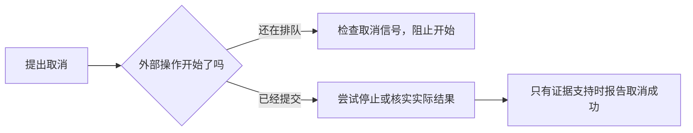

# 异步任务如何处理过期取消与超时

整理日期：2026-11-05  
分类：软件工程 → 异步任务

**一个结果计算成功，不代表现在仍然有资格使用。任务身份、状态版本和剩余时间都需要检查。**

## 本篇学习重点

- **建议掌握**：结果晚回来可能已失效；取消不等于撤销，超时信号不等于强制退出。
- **用时查阅**：取消信号 API、版本字段和超时数值。
- **可以要求 Codex**：请检查旧结果能否写入新会话，并说明无法取消时的行为。

## 为什么旧结果会出问题

模型还在规划羊了个羊时，用户切到了星露谷。几秒后旧规划返回，如果程序只判断“请求成功”，就可能对新游戏执行旧动作，或者播报已经过时的解说。

设计上可给任务关联 `gameId`、`sessionId`、状态版本和取消信号：

- 游戏 ID 表明结果属于哪个游戏。
- 会话 ID 区分同一游戏的不同运行阶段。
- 状态版本区分操作依据的新旧。
- 取消信号通知参与步骤停止工作。

在执行或写入前重新核对这些信息，避免失效结果继续产生影响。

版本不能仅用不断变化的帧号或时间戳，否则实时游戏可能一直被判过期；也不能忽略动作依赖的重要变化。复查与实际输入之间仍可能发生状态变化，所以执行器需在输入边界校验版本或动作前提。一次预检查不提供原子操作保证。

## 整轮截止时间与单次超时

如果每次请求最多 30 秒，重试三次就可能接近 90 秒，另外还有排队和退避等待。

整轮预算可以设定一个固定截止时刻，后续各阶段只使用剩余时间：

```text
剩余时间 = 截止时刻 - 当前时刻
```

排队、请求、重试和格式修复都要受这一截止时间约束。可以另设阶段上限，但重试不能凭空重新获得完整预算。这里的秒数只是解释用的例子，不是推荐生产配置。

截止时间通常触发取消信号，不代表强制停止整个进程。本项目生成预算明确不包含语音播放，清理也可能继续占用调度槽；游戏运行器遇到不响应取消的操作会等待，而不提前开放新游戏输入。这是安全与及时恢复之间的取舍，不能承诺到点全部退出。

Harness 的处理又有所不同：character-provider.mjs（私人资料，未公开）尝试终止子进程，并在约 3 秒后兜底结束等待。兜底返回并不证明子进程已退出，尤其不能据此排除终止失败时的残留。本次已核对这一代码路径，但没有通过故障注入确认残留是否实际发生；它应保留为待验证风险。

## 取消不是撤销已经发生的事



图示只说明判断顺序；能否真正停止，取决于执行器与下游能力。

点歌尚在队列时，取消可以阻止它开始；如果已提交给播放器，能否撤回取决于播放器是否提供相关能力，不能一律报告取消成功。

因此要区分等待中、已提交、已确认、结果未知等状态。整轮取消后，即使外部操作已经发生，旧结果也不能随意写回新会话。

同样，已播出的首句无法撤回，应按确认的实际播报记录部分对话；不能把未播完的文本当作观众已听到的内容。

## 回顾问题

- 单次请求成功后，执行前还需要检查什么？
- 为什么“每次请求超时 30 秒”不能保证整轮 30 秒内结束？
- 取消一个任务，是否代表外部操作已经撤销？

## 来源

- 总设计师聊天（私人资料，未公开），第 1、4、15 至 17 轮。
